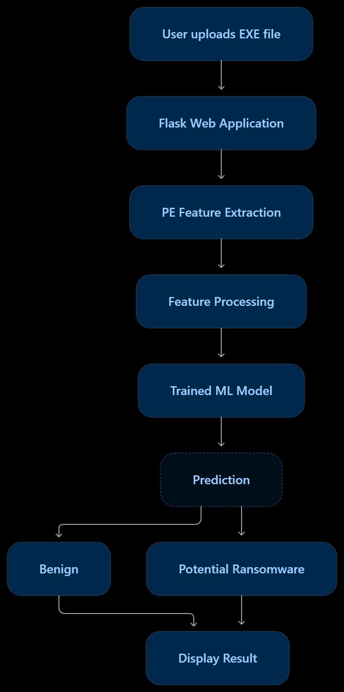
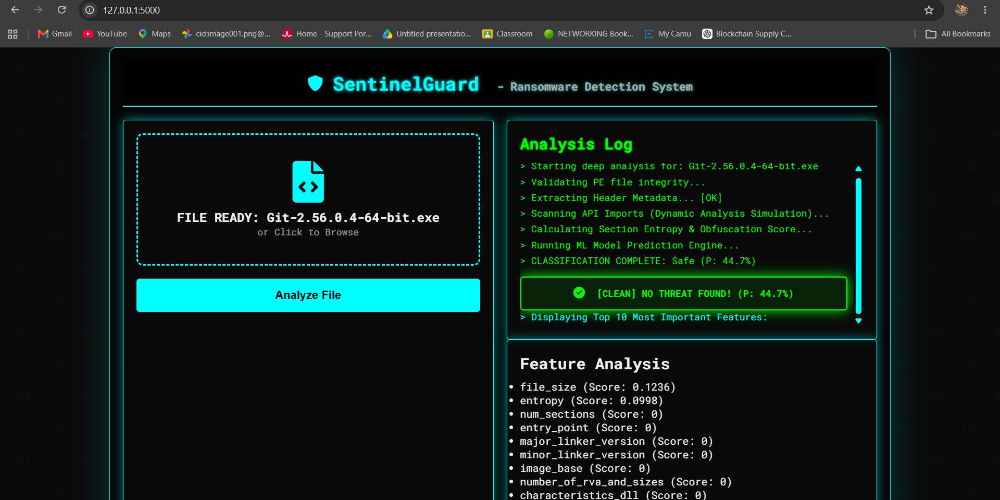

# SentinelGuard – Ransomware Detection System

## Overview

SentinelGuard is a Machine Learning-based ransomware detection system designed to analyze executable files and identify potentially malicious behavior using extracted PE (Portable Executable) file features.

The system uses a trained Machine Learning model to classify files and provides predictions through a Flask-based web application.

## Key Features

- Machine Learning-based ransomware detection
- PE file feature extraction and analysis
- Automated file classification
- Web-based interface using Flask
- Prediction results through a user-friendly dashboard

## Technologies Used

- **Programming:** Python
- **Backend:** Flask
- **Machine Learning:** Scikit-learn
- **Data Processing:** Pandas, NumPy
- **Frontend:** HTML, CSS, JavaScript
- **Model Storage:** Pickle

## Project Structure

```text
SentinelGuard/
├── data/
├── models/
├── static/
│   ├── css/
│   └── js/
├── templates/
├── utils/
├── app.py
├── train_model.py
├── generate_dummy_model.py
├── requirements.txt
└── README.md
```

## Installation and Setup

### 1. Clone the repository

```bash
git clone https://github.com/prashnt1260/SentinelGuard-Ransomware-Detection.git
```

### 2. Navigate to the project directory

```bash
cd SentinelGuard-Ransomware-Detection
```

### 3. Create a virtual environment

```bash
python -m venv venv
```

### 4. Activate the virtual environment

**Windows:**

```bash
venv\Scripts\activate
```

**Linux / Kali:**

```bash
source venv/bin/activate
```

### 5. Install dependencies

```bash
pip install -r requirements.txt
```

### 6. Run the application

```bash
python app.py
```

Open your browser and visit:

```text
http://127.0.0.1:5000
```

## System Architecture



## Screenshots

### Ransomware Detection Result



## Future Improvements

- Improve detection accuracy
- Add more malware analysis features
- Enhance the user interface
- Expand model training with additional datasets

## Disclaimer

This project is developed for educational and cybersecurity research purposes. Do not upload or execute real ransomware samples on your personal system.

## Author

**Prashant Gaikwad**

GitHub: https://github.com/prashnt1260
